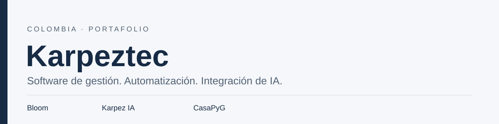
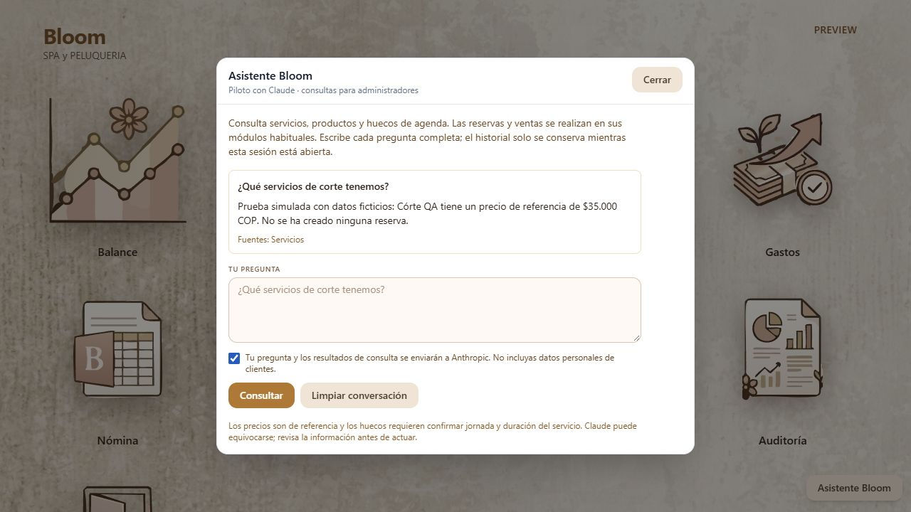
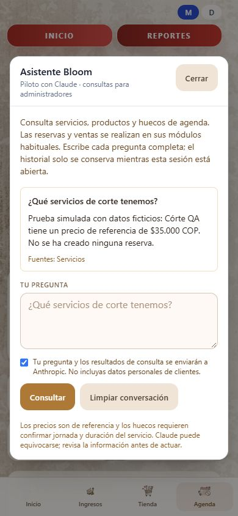

# Karpeztec · Portafolio de proyectos

Nuestra oferta propia es **Microapps Karpeztec: aplicaciones adaptables para negocios**. **Bloom es un producto desarrollado por Karpeztec, en operación para un cliente y evolucionando hacia un asistente con Claude.** Bloom es la marca de ese cliente; el asistente sigue en piloto local. Operamos desde Cali, Valle del Cauca, Colombia. Fundador: **Carlos Padilla**. Karpeztec comenzó a operar en **marzo de 2025**. Emprendimiento autofinanciado, sin inversión externa.

**Web corporativa:** [karpeztec.com](https://karpeztec.com/). **Estado registral:** inscripción como **Karpeztec S.A.S.** en preparación ante la Cámara de Comercio de Cali; la matrícula y constitución legal no están completadas. Marzo de 2025 es el inicio operativo, no una fecha de registro jurídico.

Esta presentación reúne productos, prototipos y evidencia de desarrollo. El código de los productos y los datos del negocio se mantienen privados.

| Proyecto | Propósito | Estado al 11 de octubre de 2026 |
| --- | --- | --- |
| [Microapps Karpeztec](projects/microapps.md) | Oferta adaptable para un negocio (Single) y propuesta para varias sedes (Enterprise) | Oferta comercial en preparación; tarifas por cotización. |
| [Bloom · nuestro desarrollo en operación](projects/bloom.md) | Gestión de SPA y peluquería: agenda, ingresos, tienda y comisiones | En uso en un salón real, según Carlos Padilla. Asistente Claude en pruebas locales. |
| [Karpez IA](projects/karpez-ia.md) | Entorno para trabajar con modelos locales y adaptadores de proveedores | En desarrollo; integración comercial y validación de proveedores pendientes. |
| [CasaPyG](projects/casapyg.md) | Monitorización y automatización del hogar | Prototipo; integración y validación con dispositivos pendientes. |

## Bloom en operación y evolución hacia Claude

Bloom combina **Next.js, TypeScript, FastAPI y SQLite** para organizar las operaciones del salón. Estamos preparando una integración con Claude para consultar servicios y precios, productos y disponibilidad de agenda mediante herramientas controladas por permisos.

La integración está implementada localmente para administradores y en modo de consulta. Las pruebas utilizaron respuestas simuladas de Claude y datos ficticios. **La llamada real a la API y el despliegue del asistente siguen pendientes.**

### Captura real del piloto local · escritorio

### Captura real del piloto local · móvil

Las capturas corresponden a la interfaz implementada, no a una demostración de uso real de la API. Se verificaron permisos, restricciones de herramientas, idempotencia, límites de uso y omisión de nombres y teléfonos de clientes en resultados de herramientas; 13 pruebas automatizadas, TypeScript y ESLint aprobados.

## Interacción con IA

[Ver las demostraciones](https://karpeztec.com/#demostraciones) · [Índice de proyectos y capturas](DEMOS.md)

| Proyecto | Recorrido ilustrativo | Estado |
| --- | --- | --- |
| [Bloom](projects/bloom.md) | Consultar servicios, productos y disponibilidad con Claude. | Producto en operación; asistente en piloto local. |
| [Karpez IA](projects/karpez-ia.md) | Trabajar con contexto, documentos y acciones propuestas. | En desarrollo. |
| [CasaPyG](projects/casapyg.md) | Consultar sensores y revisar una escena antes de confirmarla. | Prototipo. |

## Diseño y dirección de desarrollo

Las demostraciones utilizan composiciones distintas: Bloom muestra una agenda por profesional y módulos; Karpez IA, conversaciones y un documento; CasaPyG, sensores y habitaciones. Referencias de diseño: [Fresha](https://www.fresha.com/for-business/features/scheduling), [LM Studio](https://lmstudio.ai/docs/app/basics/chat) y [Home Assistant](https://www.home-assistant.io/blog/2024/03/04/dashboard-chapter-1/). Se tomaron patrones de organización, sin copiar capturas ni anunciar equivalencia funcional.

- Microapps: preparar KarpezBarber/KarpezBeauty con modalidades Single y Enterprise.
- Bloom: nuestro desarrollo en operación para un cliente; validar el piloto con Claude antes de anunciarlo en producción.
- Karpez IA: consolidar el entorno local y comprobar cada adaptador de proveedor.
- CasaPyG: validar escenarios de monitorización y automatización con dispositivos reales.

## Caso de cliente: Bloom

1. Organizar citas, profesionales y bloqueos de horario.
2. Registrar los servicios realizados, las ventas y los movimientos de inventario.
3. Revisar ingresos, gastos y comisiones mediante caja y reportes diarios y mensuales.

El uso actual en **un salón real** fue confirmado por Carlos Padilla. Las muestras de este repositorio son de un entorno local con datos ficticios; no prueban ingresos, clientes de pago ni resultados comerciales. La validación con la API real de Claude está pendiente.

La dirección comercial propuesta contempla una oferta por negocio y, posteriormente, una oferta para varias sedes, incluidos salones pequeños y barberías. Las tarifas propuestas están en la [ficha de microapps](projects/microapps.md); la disponibilidad de Enterprise sigue pendiente; no se presenta como una función ya desplegada.

## Oferta comercial

[Microapps y tarifas propuestas](projects/microapps.md): Single desde $60.000 COP/mes; Enterprise desde $200.000, dos sedes y hasta 15 profesionales en total. Tarifas de planificación sujetas a cotización; Enterprise todavía no está desplegado. El modelo también contempla instalaciones privadas por alcance. Las demos no acreditan funciones de producción ni resultados comerciales.

## Contacto

**Carlos Padilla · Fundador de Karpeztec**  
[ingpadceo@karpeztec.com](mailto:ingpadceo@karpeztec.com) · [LinkedIn](https://www.linkedin.com/in/carlos-padilla-6a4a4a162/)

Para conocer Bloom, solicita una presentación por el correo empresarial. La vitrina pública muestra el producto con datos ficticios; el acceso operativo se entrega a usuarios autorizados por separado.

### English overview

Karpeztec is a self-funded software venture based in Cali, Colombia, operating since March 2025. Our own offering is Microapps Karpeztec. Bloom is a client brand and a working client application used in one salon, as confirmed by Carlos Padilla. Its admin-only, read-only Claude integration has been implemented locally and tested with simulated responses and fictional data; live API validation and deployment are pending. Registration as Karpeztec S.A.S. is being prepared and is not complete. Karpez IA and CasaPyG are development projects. This repository contains presentation materials, not product source code.

© 2026 Carlos Padilla / Karpeztec. Derechos reservados. Véase [aviso de uso](NOTICE.md). Esta vitrina no implica asociación, certificación ni aprobación por Anthropic o por otros proveedores.

**Producto en operación:** [acceso de usuarios autorizados a Bloom](https://app.bloomsalonypeluqueria.com/login?next=%2F). La evolución con Claude se describe en la ficha, separando el software operativo del piloto local.
