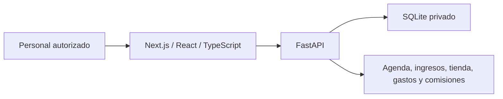

# Bloom · Arquitectura y límites de la evidencia

Resumen documental al 21 de octubre de 2026. El producto está en uso en un salón según Carlos. Se consultaron las instrucciones técnicas locales y el manifiesto del frontend; no se accedió a datos del cliente ni se ejecutaron pruebas sobre producción.

La documentación local describe transacciones explícitas, idempotencia para operaciones críticas y permisos por roles. Su presencia documental no constituye una auditoría de seguridad completa. El frontend declara Next.js 14 y React 18.

El asistente Claude es un piloto local separado del estado operativo de Bloom. Las capturas existentes usan datos ficticios y respuestas simuladas; no demuestran llamadas reales a la API ni despliegue del asistente. Las cifras de pruebas citadas previamente en el showcase son evidencia histórica reportada, no pruebas ejecutadas en esta preparación.

## Decisión editorial

Publicar arquitectura de alto nivel y escenarios sintéticos; conservar código, esquema completo, infraestructura, bases, comprobantes y registros privados. Bloom es marca del cliente. No se supone autorización para redistribuir sus activos.

## Guion de demo segura pendiente de grabación

En un entorno aislado con datos inventados: crear una cita ficticia, registrar un servicio ficticio, revisar inventario sintético y mostrar un reporte de esos movimientos. Ocultar direcciones operativas, sesiones, notificaciones y datos reales. Etiquetar cualquier respuesta de IA simulada en pantalla. No usar exportaciones de producción para poblar el entorno.

No se adjunta una grabación nueva ni se afirma que este recorrido haya sido ejecutado aquí.
