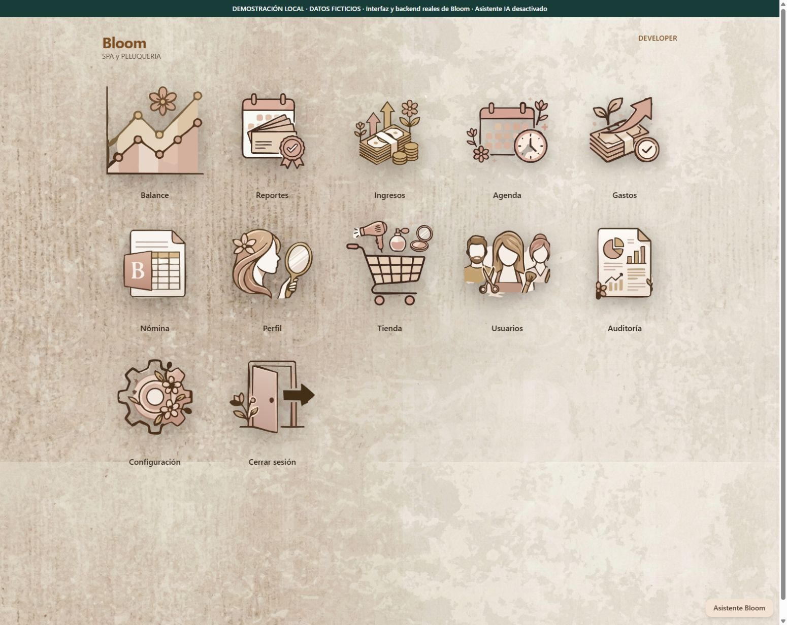
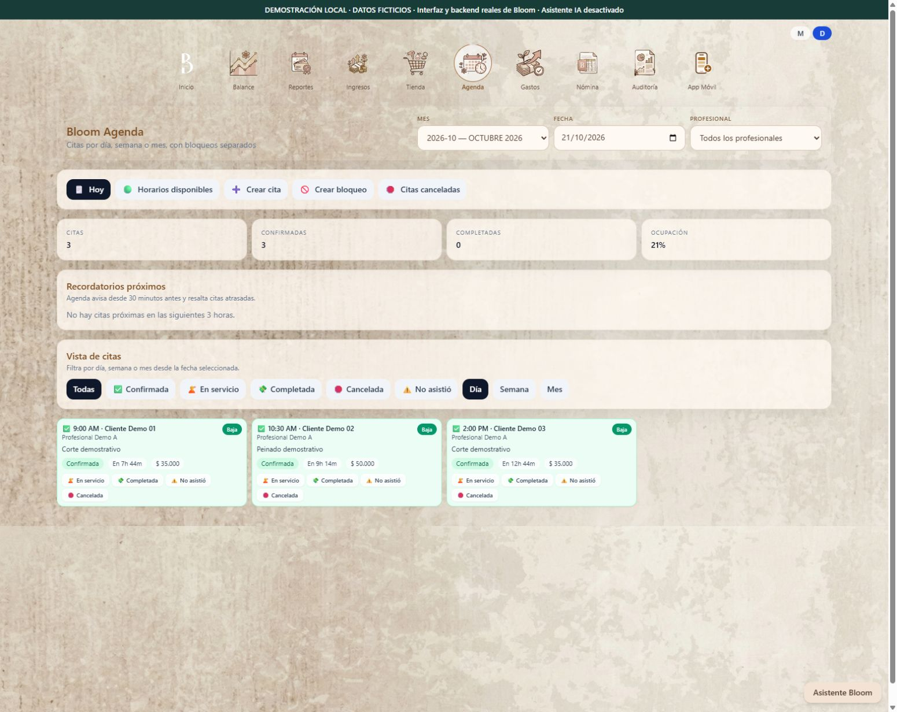
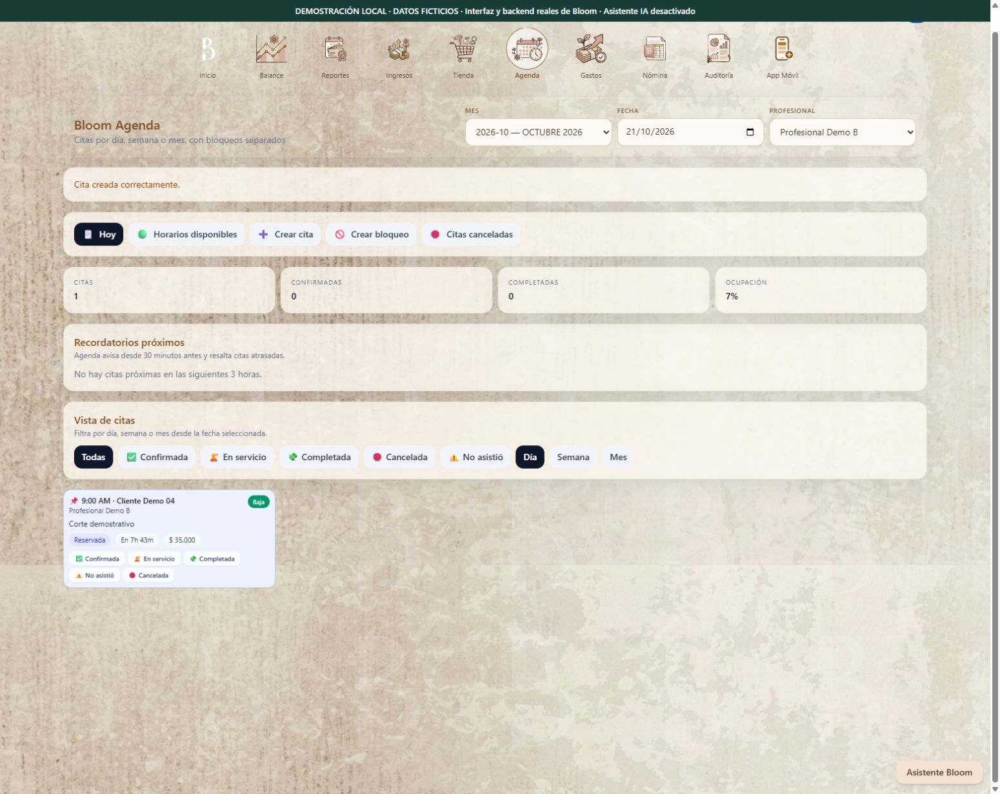
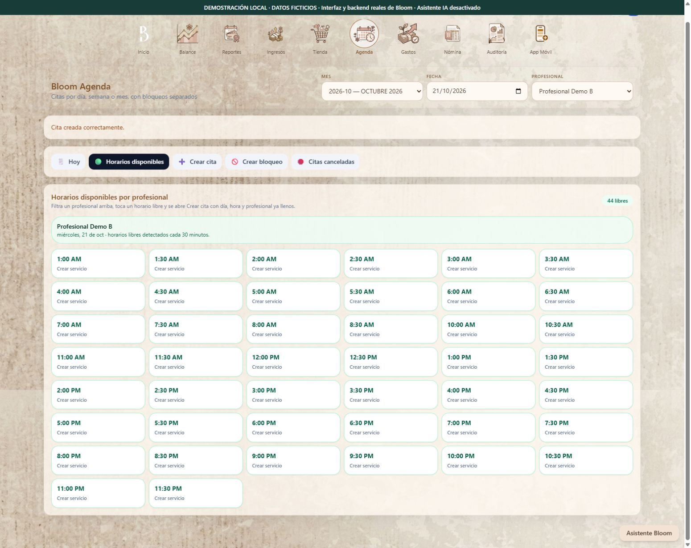
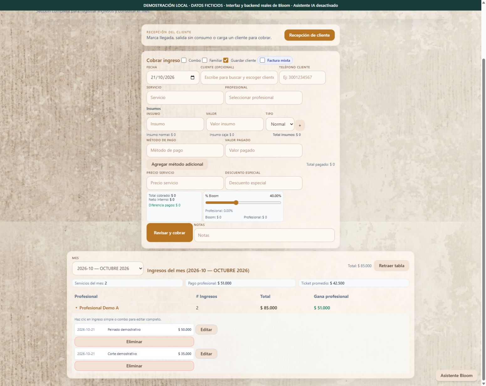
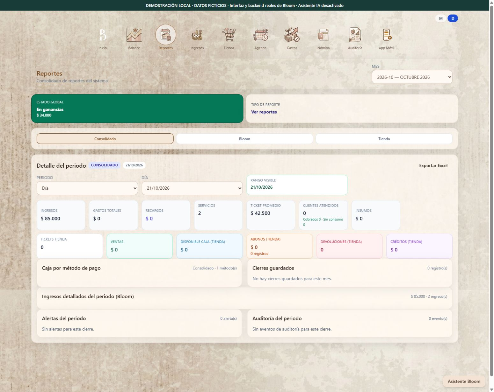

# Bloom · Demostración con la aplicación real y datos ficticios

Fecha: 21 de octubre de 2026. Estado: recorrido real de la copia local verificado y capturado; video continuo con narración aún no realizado.

## Recorrido en seis capturas reales

Las seis imágenes se capturaron del navegador mientras se operaba la copia aislada. No son maquetas generadas. La banda superior identifica el entorno ficticio; cualquier cifra de servicios, ocupación, caja o ganancias que aparezca es un cálculo sobre esos datos inventados.

### 1. Inicio del producto

### 2. Agenda con tres citas ficticias

### 3. Crear una cita desde la interfaz

Se introdujo «Cliente Demo 04», se seleccionaron «Corte demostrativo», «Profesional Demo B», las 9:00 y una duración de 45 minutos. Al guardar, la interfaz mostró «Cita creada correctamente» y la nueva tarjeta. Es una operación real sobre la base ficticia.

### 4. Disponibilidad después de crear la cita

La vista deja de ofrecer las 9:00 y 9:30 para el profesional de la cita nueva. Los horarios abiertos son los de la configuración ficticia de esta demo; no representan la jornada del negocio real. Por separado, la comprobación de backend rechazó con HTTP 409 un solapamiento para el otro profesional.

### 5. Ingresos y detalle de servicios ficticios

### 6. Reporte generado por esos movimientos

El reporte incluye valores monetarios derivados de la semilla ficticia. No acredita ventas, rentabilidad, clientes atendidos ni resultados comerciales del salón.

## Procedencia y aislamiento

Se copió el código local de la interfaz y el backend de Bloom a una carpeta de trabajo independiente. No se copiaron bases, exportaciones, archivos de entorno ni datos del cliente. Las dependencias instaladas también se copiaron para evitar conflictos de resolución entre discos; la aplicación original no fue modificada.

Antes de crear la base nueva se sustituyeron los catálogos de origen por profesionales, clientes, servicios y precios inventados. Se desactivaron en la demo los procesos periódicos de importación, respaldo y cierre, y el asistente IA. La interfaz de la copia lleva una banda permanente: «DEMOSTRACIÓN LOCAL · DATOS FICTICIOS».

La demo ejecuta el backend y el frontend reales en una copia. Los datos y la banda identificadora son específicos de la demo. No es una maqueta de pantallas ni una sesión de producción.

## Verificaciones realizadas en el backend real copiado

| Operación con datos ficticios | Resultado observado |
| --- | --- |
| Crear tres citas demostrativas | Tres respuestas HTTP 201 |
| Solicitar otra cita que se cruza para el mismo profesional | HTTP 409: solicitud rechazada |
| Registrar dos ingresos demostrativos | Dos respuestas HTTP 201 |
| Crear otra cita desde el navegador | Confirmación visible y nueva tarjeta «Cliente Demo 04» |
| Revisar disponibilidad, ingresos y reporte en el navegador | Capturas reales con etiqueta de datos ficticios |

Los importes son inventados. No representan ventas, ingresos, facturación ni métricas del cliente. Los resultados prueban estos escenarios acotados; no certifican todos los módulos ni el despliegue operativo.

## Pruebas existentes del piloto de asistente

Se ejecutó `python -m unittest _qa_claude_assistant -v` sobre la copia aislada: **13 pruebas aprobadas** con SQLite temporal y Claude simulado. Cubren autenticación, permisos, disponibilidad, privacidad, preservación de registros, idempotencia, conflictos, herramientas desconocidas, límites y fallo del proveedor. La prueba original permanece privada por su dependencia del backend privado.

No hubo llamadas a la API real de Claude. Estos resultados no demuestran calidad de respuestas de un modelo real ni que el asistente esté en producción.

## Guion propuesto para una grabación de 90 segundos

| Tiempo orientativo | Mostrar | Explicar |
| --- | --- | --- |
| 0–15 s | Etiqueta de demo y agenda del día con nombres Demo | «Soy Carlos. Construí Bloom con Codex y ChatGPT mediante Roo Code, dirigiendo requisitos, pruebas y correcciones». |
| 15–35 s | Citas ficticias y formulario de una cita nueva | Cómo el personal organiza la agenda. Mostrar confirmación real antes de afirmar que quedó creada. |
| 35–50 s | Intento de cita superpuesta | La comprobación del backend rechaza un solapamiento. No ocultar fallos del recorrido. |
| 50–70 s | Ingresos y reporte de los servicios ficticios | Diferenciar registros demostrativos de resultados comerciales. |
| 70–90 s | Resultado de pruebas y límites | Mostrar pruebas reales, aclarar que el asistente IA sigue siendo un piloto y que los datos son ficticios. |

Este es un guion para una posible grabación continua con narración, aún no realizada. El recorrido visual anterior sí fue operado y capturado. Las imágenes antiguas del showcase corresponden al piloto de asistente con respuestas simuladas; estas seis capturas nuevas muestran el producto operativo en una copia con datos ficticios y el asistente desactivado.

## Atribución

Carlos confirma que Bloom fue construido enteramente con Codex y ChatGPT mediante la extensión Roo Code, mientras él dirigía el desarrollo, probaba y corregía el producto. Se registra como declaración del propietario, sin reparto porcentual entre herramientas ni auditoría de autoría por commit. Roo Code es la extensión utilizada; no se presenta como una extensión oficial de OpenAI.
